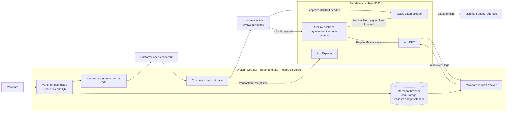

# ArcLink

**Create a USDC payment request. Share one link. Receive the payment in your wallet.**

ArcLink is a payment-link and checkout app for one-time, fixed-amount USDC payments on Arc Mainnet. It is designed for freelancers, creators, small businesses, pop-up vendors, and event organizers who want to request a specific payment without building a full online store.

A merchant creates a link or QR code. A customer opens it, checks the details, connects a wallet, approves the USDC allowance if needed, and confirms payment. The ArcLink smart contract forwards the exact payment to the merchant's payout address in the same transaction.

- **Live app:** [usearclink.vercel.app](https://usearclink.vercel.app/ )
- **Arc Studio project:** [Open ArcLink in Arc Studio](https://studio.arc.io/app/ec1fdd68-0d5e-4a51-bd6f-494cb1526bdd )
- **GitHub repository:** [Miracle-Alajemba/arclink](https://github.com/Miracle-Alajemba/arclink )
- **ArcLink contract:** [0x973AA3397d218a12765388E2006E6603Bf83222a](https://explorer.arc.io/address/0x973AA3397d218a12765388E2006E6603Bf83222a )
- **Contract deployment transaction:** [View on Arc Explorer](https://explorer.arc.io/tx/0xf86c8115e5132b06898bef14fd219163f1e6af95cb261b2cd77f2233f3d7ebeb )
- **Example USDC payment transaction:** [View on Arc Explorer](https://explorer.arc.io/tx/0x984e68f9216b4b7bc5a194360051a32f8dd2f3b3a99f6bc16a5039f48b72caf2 )

## Built with Arc Studio

ArcLink was built and iterated on in Arc Studio, from the Solidity payment-forwarding contract and its Foundry tests to the web application and payment-request flow. The contract's current Foundry test suite reports **14 passing tests**.

The project is deployed on Arc Mainnet and has an example successful USDC payment transaction. In that test, the payer and payout address were the same wallet; it demonstrates the payment flow but is not a test between two independent wallets.

## The problem ArcLink addresses

A seller often needs a simple way to ask for one exact amount: a freelancer collecting an invoice, an artist selling a digital item, a market vendor taking payment at a stall, or an organizer collecting an event fee. ArcLink lets the seller create a link or QR code instead of sending wallet details and payment instructions separately.

ArcLink is intentionally focused on **one payer, one merchant, and one fixed amount per request**. It is not a shopping cart, card processor, subscription service, escrow, accounting system, or split-payment product.

## How to use ArcLink

### 1. Create a payment request as the merchant

Open the live app and choose **Create a payment link**. In the merchant dashboard, enter:

- **Business name:** the name customers should see, such as `Acme Coffee`.
- **Payout address:** the public wallet address that should receive the USDC. This is the actual recipient of the payment. You can use your own wallet address; the dashboard's **Connect Wallet** button does not send money and does not change the payout address.
- **Amount:** the exact payment requested, such as `4.50` USDC for a coffee order.
- **Private label (optional):** a note for your own request list, such as `Order 142`. It stays in local browser storage and is not sent on-chain. Do not use it for passwords, recovery phrases, or other secrets.

Select **Generate payment link**. ArcLink creates a shareable URL and a QR code. You can copy the URL and send it to the customer, or show the QR code for scanning.

### 2. Review and pay as the customer

The customer opens the payment link and should check the business name, payout address, amount, and Arc Mainnet label before proceeding. The customer connects the wallet that will pay. This is normally a different role from the merchant's payout wallet, although a person testing their own app may control both wallets.

If the wallet has not already approved enough USDC for ArcLink, it will first ask the customer to approve the requested USDC amount. The customer then confirms the payment transaction. Depending on the wallet's existing allowance, this may require one or two wallet confirmations. The customer must have enough balance for the payment and the fee shown in the wallet.

**Before confirming, the customer should verify the recipient address, amount, network, and fee in the wallet.** Payment-link details are encoded in the URL and are not a signed invoice; do not rely on a link alone if its details differ from what the merchant told you.

### 3. Confirm settlement

After the payment transaction succeeds, the checkout shows the real transaction hash and a link to Arc Explorer. The merchant can open **Requests** in the dashboard and refresh the tracker. The tracker looks for the matching `PaymentMade` event and marks a request **Paid** when the on-chain amount matches the request. A matching reference with a different amount is shown as **Needs review**.

## Who connects which wallet?

- **Merchant dashboard wallet:** The wallet shown by the dashboard's Connect Wallet control. Connecting it does not send funds. The payout address entered in the form determines where the payment goes. They can be the same address.
- **Payout address:** The recipient wallet address in the payment request. This is where ArcLink forwards the USDC.
- **Customer wallet:** The wallet connected on the checkout page. This wallet approves USDC and makes the payment.

Never enter or share a wallet's private key or recovery phrase in ArcLink. ArcLink needs only public wallet addresses and customer signatures in their own wallet interface.

## Architecture at a glance



The merchant creates the request in the browser; the customer signs the payment with their own wallet. ArcLink calls the USDC token contract to move the exact amount to the payout address. The tracker reads the public `PaymentMade` event from Arc RPC and combines it with the request record saved in that merchant's browser. Arc Explorer is where either party can inspect the transaction.

## What happens on-chain?

The ArcLink contract is a small, stateless Solidity contract. It accepts only the USDC token address pinned when the contract was deployed. When a customer pays, the contract:

1. Checks that the merchant address and amount are valid and that the supplied token is the pinned USDC contract.
2. Pulls the approved USDC amount from the customer using `transferFrom`.
3. Immediately forwards that same amount to the merchant's payout address.
4. Checks that its USDC balance did not increase because of the payment.
5. Emits a `PaymentMade` event containing the merchant, payer, amount, and tracking reference.

The contract has no owner/admin role, protocol fee, or upgradeability mechanism. The reference is public on-chain, so it must not contain personal or sensitive information. The contract is not audited or endorsed by Arc or Circle; users should review it and use appropriate caution.

## Arc Mainnet settings

| Setting | Value |
| --- | --- |
| Network | Arc Mainnet |
| Chain ID | `5042` |
| RPC endpoint | `https://rpc.mainnet.arc.io` |
| Block explorer | [explorer.arc.io](https://explorer.arc.io ) |
| USDC token contract | `0x3600000000000000000000000000000000000000` |
| ArcLink contract | `0x973AA3397d218a12765388E2006E6603Bf83222a` |
| Deployment transaction | [View on Arc Explorer](https://explorer.arc.io/tx/0xf86c8115e5132b06898bef14fd219163f1e6af95cb261b2cd77f2233f3d7ebeb ) |
| Example USDC payment transaction | [View on Arc Explorer](https://explorer.arc.io/tx/0x984e68f9216b4b7bc5a194360051a32f8dd2f3b3a99f6bc16a5039f48b72caf2 ) |

The USDC token address identifies the payment token on Arc. The ArcLink contract address identifies the app's payment-forwarding contract. The deployment transaction created the contract; the separate example payment transaction shows a successful USDC payment through the app. For this test, the payer and payout address were the same wallet.

## Request history and privacy

ArcLink saves request records in the current browser's local storage, grouped by merchant payout address. Records are not synced to an ArcLink server or automatically shared with another device or browser. Clearing browser storage can remove the local request history.

The optional private label stays in the browser. The generated `ARCL-...` tracking reference is included in the payment URL and is emitted in a public blockchain event. Do not put customer names, email addresses, phone numbers, or sensitive order information in the tracking reference.

## Run the project locally

### Requirements

- [Bun](https://bun.sh/ ) for the web application and scripts.
- [Foundry](https://book.getfoundry.sh/ ) for Solidity compilation and contract tests.

### Install and configure

```bash
git clone https://github.com/Miracle-Alajemba/arclink.git
cd arclink
bun install --frozen-lock
